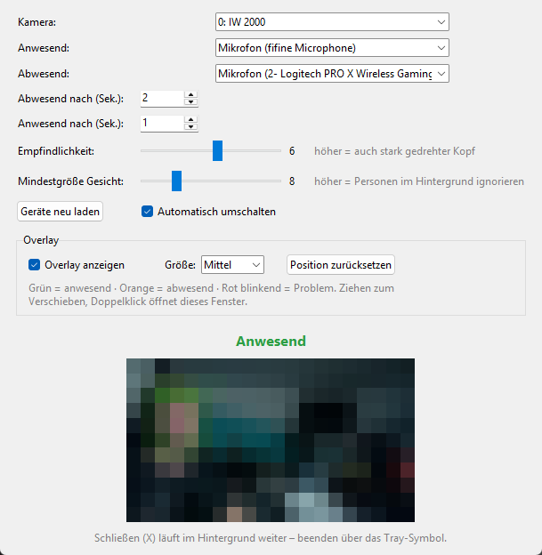

# Anwesenheit Audio

**Wechselt automatisch dein Mikrofon, je nachdem ob du vor dem PC sitzt.**
Die Webcam erkennt dein Gesicht. Bist du da, wird z. B. dein Tischmikrofon zum Windows-Standard-Aufnahmegerät; stehst du auf, wechselt es z. B. auf das kabellose Headset.

*[English version below](#english)*



## Funktionen

- Anwesenheitserkennung per Webcam (Gesichtserkennung mit dem YuNet-Modell von OpenCV – erkennt auch seitlich gedrehte Köpfe)
- Freie Wahl von Kamera, Mikrofon für „anwesend“ und Mikrofon für „abwesend“
- Einstellbare Verzögerungen (wann gilt man als weg / wieder da)
- **Empfindlichkeit**: wie stark der Kopf gedreht sein darf
- **Mindestgröße Gesicht**: ignoriert Personen im Hintergrund
- Kleines **Overlay** (immer im Vordergrund): grün = anwesend, orange = abwesend, rot blinkend = Problem
- Läuft im Hintergrund mit Tray-Symbol, optional Autostart mit Windows
- Startet die Kamera automatisch neu, falls sie hängen bleibt

## Datenschutz

Das Kamerabild wird **ausschließlich lokal** auf deinem PC verarbeitet.
Es wird **nichts gespeichert, aufgezeichnet oder ins Internet gesendet**. Das Programm hat keinerlei Netzwerkfunktion (außer einem lokalen Port `127.0.0.1:47863`, damit es nur einmal gleichzeitig läuft).
Die Einstellungen liegen in `%APPDATA%\AnwesenheitAudio\einstellungen.json`.

Hinweis: Solange das Programm läuft, ist die Kamera in Benutzung (die Kamera-LED leuchtet).

## Installation

1. `AnwesenheitAudio_Setup.exe` von der [Releases-Seite](../../releases) herunterladen und ausführen (keine Administratorrechte nötig).
2. Optional „Beim Windows-Start automatisch im Hintergrund starten“ anhaken.
3. Im Programm die Kamera und die beiden Mikrofone auswählen – fertig.

> Windows zeigt bei unsignierten Programmen eventuell „Der Computer wurde durch Windows geschützt“. Über *Weitere Informationen → Trotzdem ausführen* lässt es sich starten.

## Bedienung

| Element | Bedeutung |
|---|---|
| Schließen (X) | Fenster wird ausgeblendet, Programm läuft im Hintergrund weiter |
| Tray-Symbol | Klick öffnet das Fenster, Rechtsklick → *Beenden* beendet es wirklich |
| Overlay | Ziehen zum Verschieben, Doppelklick öffnet das Fenster |
| Zahl „Gr.“ in der Vorschau | Breite des Gesichts in % der Bildbreite – hilft beim Einstellen der Mindestgröße |

## Aus dem Quellcode starten / bauen

Voraussetzungen: Windows 10/11, Python 3.10+

```bat
pip install -r requirements.txt
python anwesenheit_audio.py
```

- `Starten.bat` – startet das Programm aus dem Quellcode
- `Installer_bauen.bat` – baut exe (PyInstaller) und Installer ([Inno Setup 6](https://jrsoftware.org/isinfo.php) muss installiert sein)

## Technischer Hinweis

Das Setzen des Standard-Aufnahmegeräts nutzt die nicht offiziell dokumentierte Windows-Schnittstelle `IPolicyConfig` (wie auch andere Audio-Umschalter). Sie funktioniert seit Windows 7 zuverlässig, könnte aber theoretisch durch ein Windows-Update verändert werden.

## Lizenz

[MIT](LICENSE). Die Lizenzen der mitgelieferten Komponenten (OpenCV, YuNet-Modell, pystray u. a.) stehen in [THIRD_PARTY_LICENSES.txt](THIRD_PARTY_LICENSES.txt).

---

<a name="english"></a>
## English

**Automatically switches your default microphone depending on whether you are sitting at your PC.**
Your webcam detects your face. While you are present, e.g. your desk microphone becomes the Windows default recording device; when you leave, it switches to e.g. your wireless headset.

**Features:** webcam presence detection (OpenCV YuNet face detector, works with turned heads) · choose camera and microphones for "present"/"away" · adjustable delays · sensitivity and minimum face size (ignores people in the background) · small always-on-top status overlay (green / orange / blinking red on problems) · runs in the system tray, optional autostart · automatic camera restart if it hangs.

**Privacy:** the camera image is processed **locally only**. Nothing is stored, recorded or sent anywhere.

**Install:** download `AnwesenheitAudio_Setup.exe` from the [releases page](../../releases) and run it (no admin rights needed). The user interface is in German.

**Build from source:** `pip install -r requirements.txt` then `python anwesenheit_audio.py`; `Installer_bauen.bat` builds the exe and installer (requires Inno Setup 6).

**License:** [MIT](LICENSE); third-party licenses in [THIRD_PARTY_LICENSES.txt](THIRD_PARTY_LICENSES.txt).
